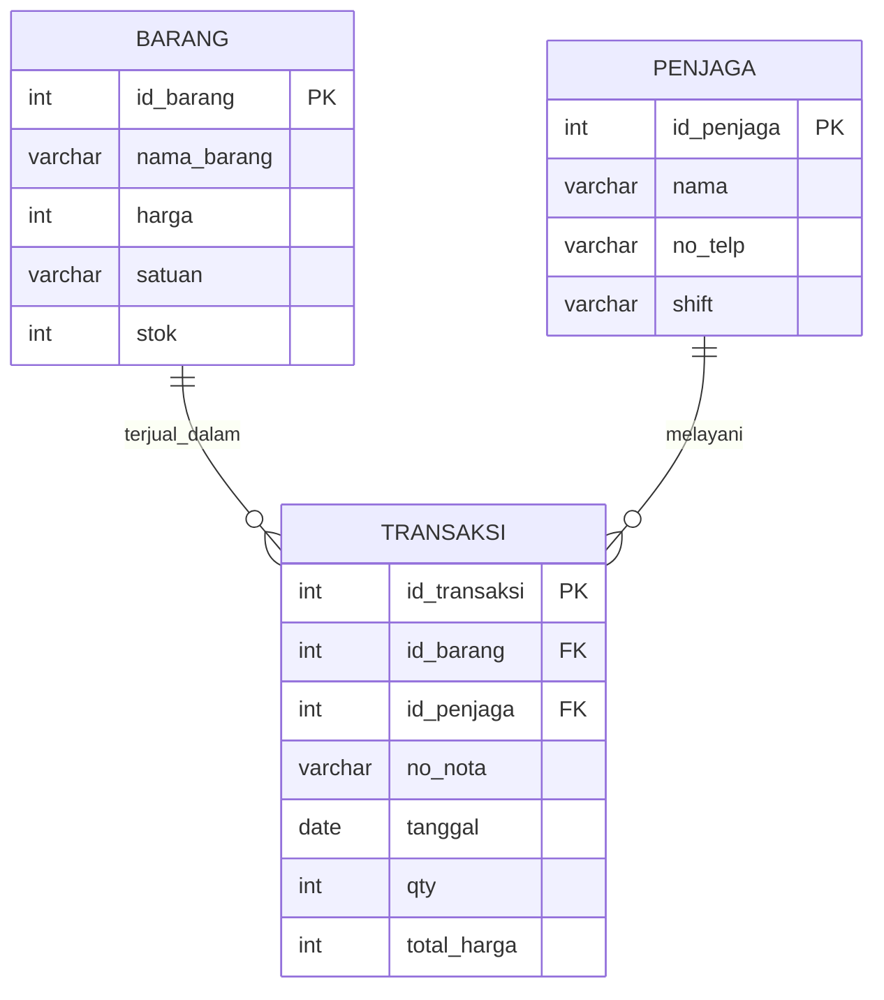

# Sistem Manajemen Toko Kelontong
Aplikasi Desktop Pengelolaan Toko Kelontong Berbasis Python & PyQt6 (UAS Pemrograman Desktop).

---

## Pembagian Tugas

| No | Anggota | Tugas / Modul |
| :---: | :--- | :--- |
| 1 | Sifa | Kasir |
| 2 | Rendi | Barang |
| 3 | Roni | Transaksi |

---

## Cara Menjalankan

```powershell
.\.venv\Scripts\activate
pip install -r requirements.txt
python code.py
```

---

## Entity Relationship Diagram (ERD)


