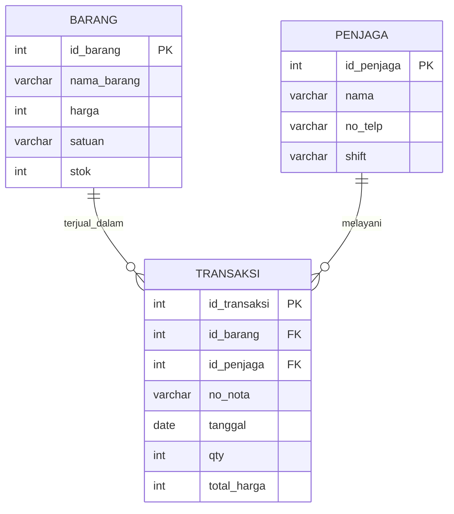

# Pemrograman Desktop - Toko Kelontong

## Cara Menjalankan

```powershell
.\.venv\Scripts\activate
pip install -r requirements.txt
python code.py
```

## Entity Relationship Diagram (ERD)



Tugas:
Sifa -> Kasir
Rendi -> Barang
Roni -> Transaksi
